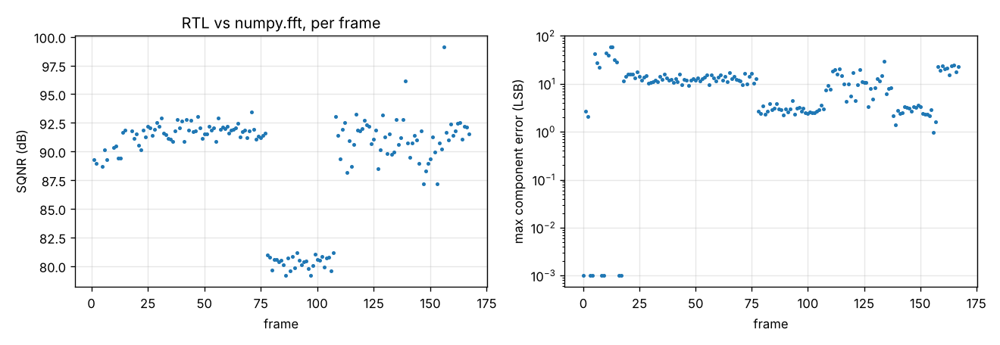

# 64-Point 16-Bit Radix-2 DIT FFT Accelerator

It accepts 64 complex input samples—each composed of 16-bit real and 16-bit imaginary lanes and computes the frequency-domain transform using an iterative single-butterfly datapath.

Sample and intermediate data are organized across a two-bank memory architecture to support read/write butterfly scheduling, and RTL correctness is verified in Verilator against a Python golden reference model.

| Item | Format |
|---|---|
| Input sample | Q1.15 real + Q1.15 imag (16 b each) |
| Twiddle | Q2.14 (16 b each), 32-entry ROM from `golden/gen_twiddle.py` |
| Internal / output | Q8.15 (23 b each), unscaled (gain 64), no saturation (overflow provably impossible; sticky `ovf` flag checks it) |
| Complex multiply | 4 multipliers, sum in 40 b, round half-up once (+2^13 >>> 14) |

## Repository Layout
```text
├── docs/       # Datapath diagram, FSM specs, and verification notes
├── rtl/        # SystemVerilog RTL
├── tb/         # testbenches and verification wrappers
├── golden/     # Python bit-accurate Radix-2 fixed-point model and stimulus generators
├── Makefile    # Verilator build and simulation
└── README.md   # Project overview
```
## Architecture

Refer to [ARCHITECTURE.md](docs/architecture.md)

## Verification
Refer to [VERFICATION.md](docs/verification.md)

## Run
    make test      # unit + system tests (4 backpressure configs)
    make unit      # unit tests only
    make sys       # system tests + golden comparison
    make lint      # Verilator -Wall on the RTL
    make model     # Python model self-test
Requires Verilator >= 5 (tested 5.020), Python 3, numpy.

## Results (168 frames: directed + random)

Bit-exact 168/168 in all four configs (IN_PROB/OUT_PROB = 100/100, 50/100, 100/30, 40/40);
SQNR vs float: min 79.2 dB (small-amplitude frame), median 91.2 dB, max 99.1 dB.
Mutation check: 5 deliberately broken RTL variants (no rounding, wrong butterfly sign,
wrong twiddle index, too-short stage gap, no bit reversal) were all caught.
