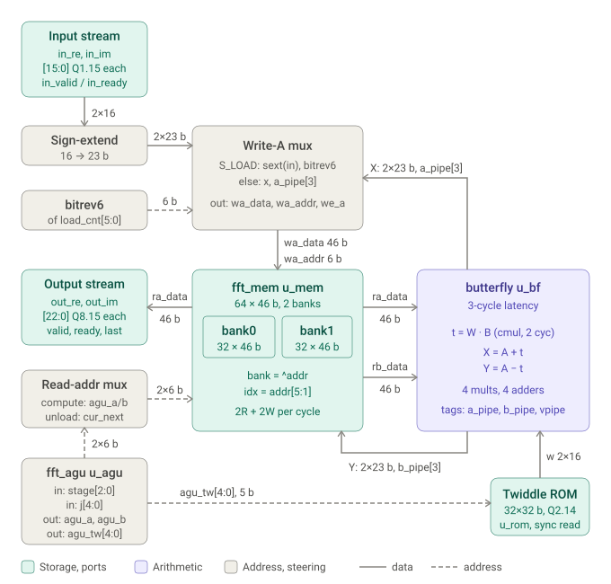

# 64-Point 16-Bit Radix-2 DIT FFT Accelerator

It accepts 64 complex input samples—each composed of 16-bit real and 16-bit imaginary lanes and computes the frequency-domain transform using an iterative single-butterfly datapath.

Sample and intermediate data are organized across a two-bank memory architecture to support read/write butterfly scheduling, and RTL correctness is verified in Verilator against a Python golden reference model.

| Item | Format |
|---|---|
| Input sample | Q1.15 real + Q1.15 imag (16 b each) |
| Twiddle | Q2.14 (16 b each), 32-entry ROM from `golden/gen_twiddle.py` |
| Internal / output | Q8.15 (23 b each), unscaled (gain 64), no saturation (overflow provably impossible; sticky `ovf` flag checks it) |
| Complex multiply | 4 multipliers, sum in 40 b, round half-up once (+2^13 >>> 14) |

Refer to [TOP.md](docs/top.md) for parameters and ports.

## Repository Layout
```text
├── docs/       # Datapath diagram, FSM specs, and verification notes
├── rtl/        # SystemVerilog RTL
├── tb/         # testbenches and verification wrappers
├── golden/     # Python bit-accurate Radix-2 fixed-point model and stimulus generators
├── Makefile    # Verilator build and simulation
└── README.md   # Project overview
```
## Architecture

Refer to [ARCHITECTURE.md](docs/architecture.md)

## Verification
Refer to [VERFICATION.md](docs/verification.md)

## Run
    make test      # unit + system tests (4 backpressure configs)
    make unit      # unit tests only
    make sys       # system tests + golden comparison
    make lint      # Verilator -Wall on the RTL
    make model     # Python model self-test
Requires Verilator >= 5 (tested 5.020), Python 3, numpy.

## Results

Per-frame verification against a `numpy.fft` golden reference demonstrates high fidelity across ~168 test frames, maintaining Signal-to-Quantization-and-Noise Ratio (SQNR) largely between ~87 dB and ~93.5 dB (with a distinct ~80–81 dB regime around frames 79–107).

The accompanying per-frame maximum component error stays bounded within tens of LSBs on a logarithmic scale, confirming consistent fixed-point/RTL numerical behavior across varying test frame regimes.
