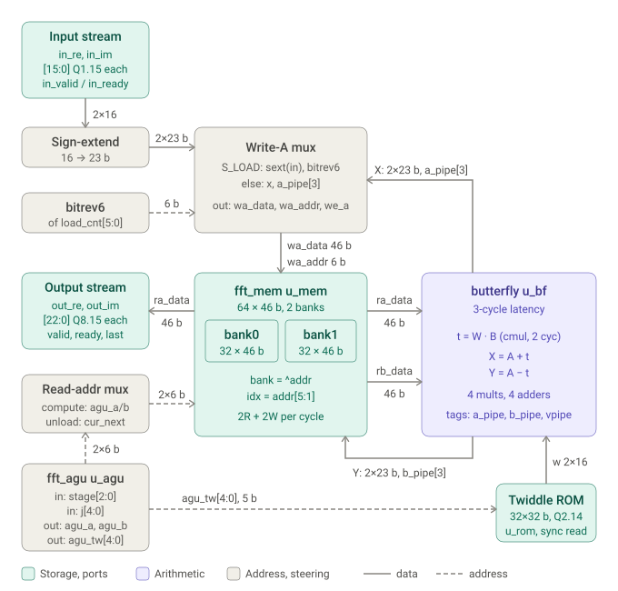
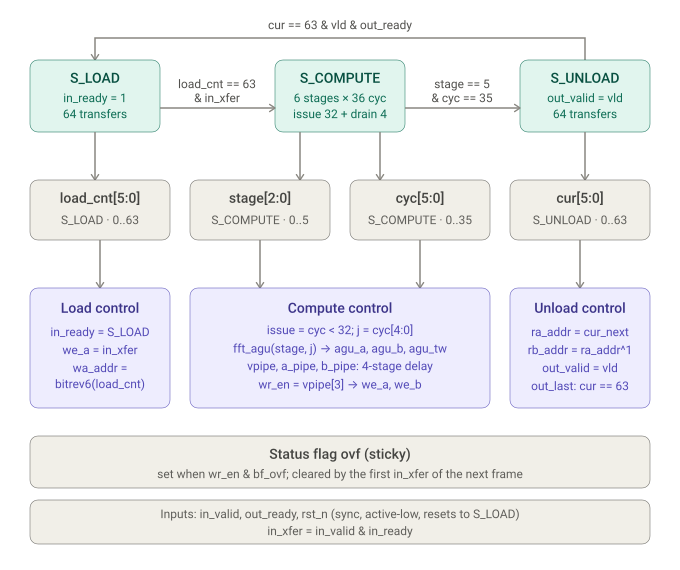

# Architecture
### Datapath Block Diagram for top level wrapper

## Memory

- Bank select is the **XOR of all 6 address bits**. A and B = A + 2ˢ differ in exactly one bit, so they always land in different banks and both can be read or written in the same cycle.
- Bank-local address is `addr[5:1]`, which is unique within a bank because the parity fixes `addr[0]`.
- Each bank is 32 × 46, with one synchronous read port and one write port. A small swap mux routes the bank outputs to the A and B paths.
- The memory is in-place, with no ping-pong.

## Datapath timing

Pipeline from address issue to write-back (L = 5 cycles, a parameter):

1. AGU issues addresses.
2. Synchronous RAM read.
3. `cmul` product registers.
4. `cmul` sum and round, giving t.
5. Butterfly outputs X = A + t and Y = A − t, registered.
6. Write-back.

A must be delayed alongside the multiplier so it meets t. A stage can't start reading until the previous stage's last write has landed, so the FSM **stalls for L cycles between stages**.

- Compute time: 6 × (32 + L) = **222 cycles**
- Whole frame, non-overlapped: roughly 64 load + 222 compute + 64 unload ≈ 350 cycles
- Stage 0 also runs through the multiplier (W = 1), which keeps the datapath uniform.

### Block Diagram for `cmul`

## Address generation (stage s = 0..5, butterfly j = 0..31)

- A = insert a 0 bit into j at position s, so `A = ((j >> s) << (s+1)) | (j & (2ˢ−1))`.
- `B = A | 2ˢ`.
- Twiddle index = `(j mod 2ˢ) · 2^(5−s)`.

## Interface and FSM

Valid/ready streaming on both sides (AXI-Stream style), with no separate start signal:

- **Input:** `in_valid`, `in_ready`, `in_re[15:0]`, `in_im[15:0]`. A transfer happens when valid and ready are both high. The sample count is internal, so there is no `in_last`.
- **Output:** `out_valid`, `out_ready`, `out_re[22:0]`, `out_im[22:0]`, `out_last` (high on bin 63).
- **Reset:** synchronous, active-low `rst_n` **(default)**.

States: `IDLE/LOAD → COMPUTE → UNLOAD → IDLE`.

- **LOAD:** the 64 samples are written at address `bitrev6(count)`. After the 64th transfer, COMPUTE starts automatically. `in_ready` is high only in LOAD.
- **UNLOAD:** read in natural order (bit reversal is already done on load). Output uses a register stage so `out_valid` data stays stable until `out_ready`.
- **Non-goal:** a new frame can't be loaded until the previous one has been fully unloaded. There is no double buffering.

### Control Unit Block Diagram

